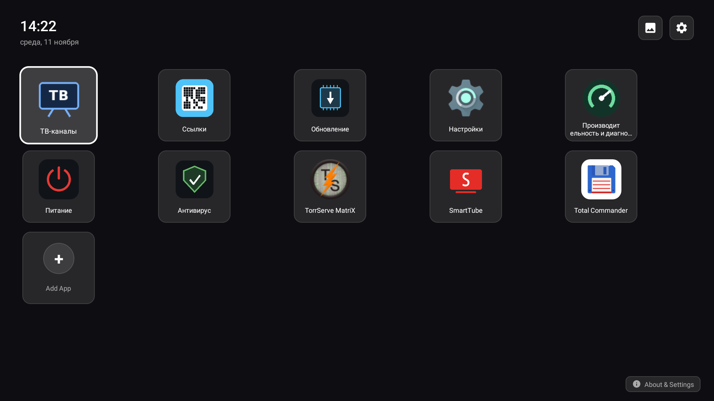
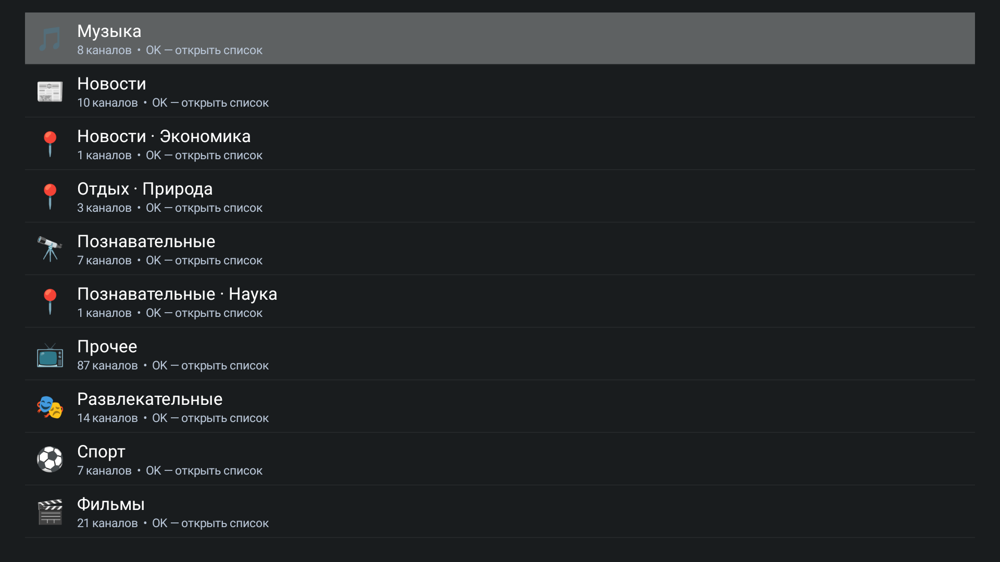
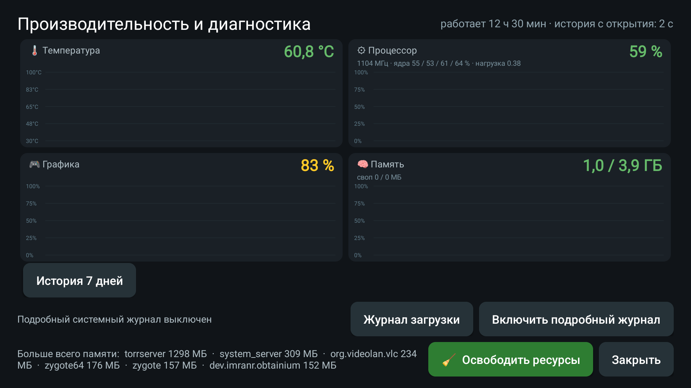
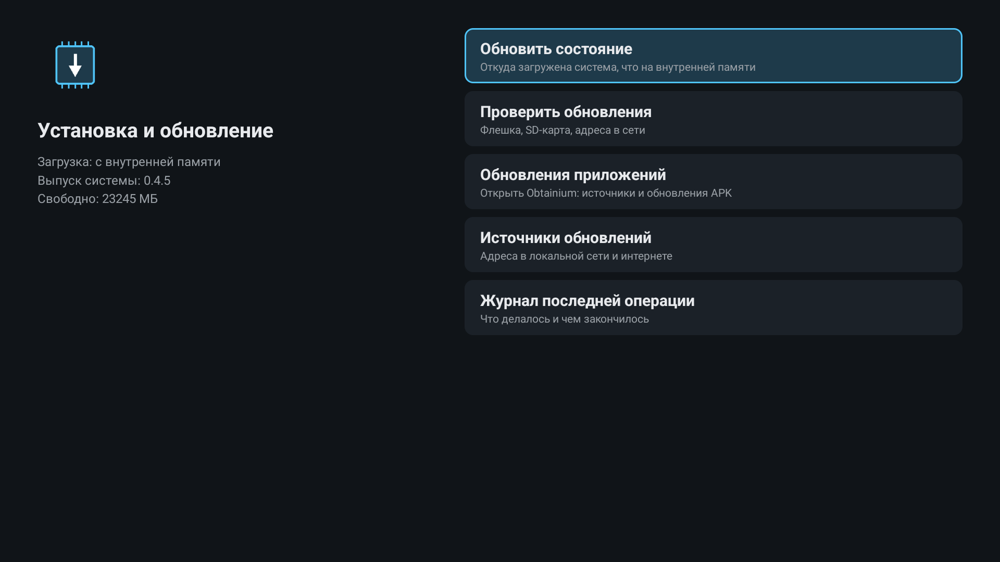

# Panadonik для H96 Max RK3318

<p align="center"></p>

Значок проекта: [`assets/icon.svg`](assets/icon.svg). Крупные образы, архивы, APK и бинарные компоненты при добавлении в Git хранятся через Git LFS; исходники, документация и SVG остаются обычными Git-файлами.

| Раздел | Ссылка |
|---|---|
| Аппаратный паспорт | [ниже](#технический-паспорт-и-исходная-база) |
| Установка со стока | [`docs/install-from-stock.md`](docs/install-from-stock.md) |
| Сборка и состояние | [`BUILD-AND-STATE.md`](BUILD-AND-STATE.md) |
| Приложения | [`APPS.MD`](APPS.MD) · [плитки](#плитки-главного-экрана) · [наши APK](#наши-приложения) |
| IPTV | [источники](#iptv-источники-и-проверка) · [`tools/iptv-sources.txt`](tools/iptv-sources.txt) |
| Релиз и CI | [GitHub Actions](#публикация-релиза-через-github-actions) · [`docs/release-quality-gate.md`](docs/release-quality-gate.md) |
| Правила агентов | [`AGENTS.md`](AGENTS.md) · [`docs/LUNA-WORKFLOW.md`](docs/LUNA-WORKFLOW.md) |
| Codex + GigaChat | [`docs/codex-gigachat.md`](docs/codex-gigachat.md) · [профили](.codex/profiles/) |
| Компоненты и подписи | [`COMPONENTS.md`](COMPONENTS.md) · [`apps-sources.md`](apps-sources.md) |
| Архитектура (draw.io) | [`docs/architecture/`](docs/architecture/) · [`panadonik-architecture.drawio`](docs/architecture/panadonik-architecture.drawio) |
| Репозиторий | [gamesmod/h96max](https://github.com/gamesmod/h96max) · [Releases](https://github.com/gamesmod/h96max/releases) · [Actions](https://github.com/gamesmod/h96max/actions) |

Для настройки локального Git и фильтров LFS установите Git LFS, затем выполните [`tools/setup-git.sh`](tools/setup-git.sh).

## Документация и источники правды

| Вопрос | Документ |
|---|---|
| Версия сборки | `ro.tvbox.release` в [`build-sd.sh`](build-sd.sh) (сейчас **0.4.12**) |
| Ограничения и процедуры | [`AGENTS.md`](AGENTS.md) |
| Доказательства приёмки | [`docs/release-qa/`](docs/release-qa/) — файл для той же версии; не переносить `pass` от более ранней |
| Критерии выпуска | [`docs/release-quality-gate.md`](docs/release-quality-gate.md) |
| Заметки кандидата | [`release/notes/0.4.12.txt`](release/notes/0.4.12.txt) |
| Незавершённые цели | [`REMAINING-GOALS.md`](REMAINING-GOALS.md) · [`GOALS.md`](GOALS.md) |
| Аудит безопасности | [`security-audit.md`](security-audit.md) · [`docs/security/`](docs/security/) |
| Исследование 4PDA / базы | [`research-4pda.md`](research-4pda.md) · [`research-base.md`](research-base.md) · [`research-apps.md`](research-apps.md) |

## Технический паспорт и исходная база

| Параметр | Проверенная конфигурация | Ссылки |
|---|---|---|
| Приставка и плата | H96 Max, синяя ревизия, продаётся как RK3318; живой A12 BSP сообщает `rk3328_box` / RK3328 | [тема 4PDA](https://4pda.to/forum/index.php?showtopic=952710) · [`research-4pda.md`](research-4pda.md) |
| Процессор и графика | Rockchip, 4 ядра Cortex-A53; Mali-450 | — |
| Память и накопитель | около 4 ГиБ ОЗУ, eMMC около 32 ГБ | — |
| Экран и индикация | HDMI ограничен 1920×1080; четырёхразрядный VFD-дисплей корпуса | — |
| Система и ядро | Android 12 userdebug, Linux 4.19.232 | [`COMPONENTS.md`](COMPONENTS.md) |
| Исходный образ | `RK3318_userdebug_H96_Max_V12_12_20221117.1447`, security patch 2022-06-05 | SHA-256 `update.img`: `e93ccc90…7cc5ad58` (полный — [ниже](#база-android-12)) |
| Пульт | USB-пульт с комплектным радиоприёмником | [USB-пульт](#usb-пульт-с-радиоприёмником) |
| Wi‑Fi / Bluetooth | Broadcom BCM4334 (SDIO + UART/HCI), firmware из стоковой A9 | [Wi‑Fi и Bluetooth](#wifi-и-bluetooth) |

Сборка основана на распакованном вендорском Android 12 образе и его разделах `system`, `vendor` и `product`; `super` распаковывается в локальные build inputs. Затем скрипты проекта удаляют/настраивают OEM-компоненты, добавляют собственные приложения и сервисы и собирают подписанное OTA для eMMC. Образ Android 9 целиком не используется; из исходной стоковой A9 на этой приставке взяты только Wi‑Fi/Bluetooth firmware и конфигурационные файлы для BCM4334. Очищенные стоковые входы и необходимые firmware хранятся в Git LFS; полный `super.img` и ключи подписи в Git не входят.

### Wi‑Fi и Bluetooth

В проверенной плате установлен комбинированный Broadcom BCM4334: Wi‑Fi подключён по SDIO и работает через `bcmdhd`, Bluetooth — через UART/HCI. Device tree Android 12 содержит ошибочную/чужую метку `rtl8822bs`, поэтому для выбора firmware ориентируются на живой SDIO ID и загруженный драйвер, а не на маркетинговую модель приставки. Для этого BCM4334 используются `fw_bcm4334b1_ag.bin`, `fw_bcm4334b1_ag_apsta.bin`, `config.txt` и `bcm4334.hcd` из стоковой A9 этой же приставки.

Тема H96 Max на 4PDA подтверждает, что под одним названием встречаются разные WLAN-комплектации: в шапке собраны отдельные firmware/драйверы для IT6334 и TX1688, а среди файлов есть образ с обозначением AP6330. Поэтому настройки и бинарники BCM4334 относятся только к проверенной плате и не должны переноситься на другую ревизию без определения чипа. Пользователи форума также сообщают о разной дальности Wi‑Fi и случаях, когда Wi‑Fi конфликтовал с Ethernet на отдельных прошивках; это наблюдения по разным экземплярам, а не подтверждённые свойства нашей платы. Сводка и ссылки на сообщения — [`research-4pda.md`](research-4pda.md), [IT6334](https://4pda.to/forum/index.php?showtopic=952710&view=findpost&p=100972072), [TX1688](https://4pda.to/forum/index.php?showtopic=952710&view=findpost&p=98471213).

Для совместимости Wi‑Fi сборка отключает автоматическое повышение WPA2 до WPA3-SAE через статический `TvboxWifiOverlay`; старый BCM4334 не поддерживает SAE. В конфигурации также отключены PMF/OCE (`pmf=0`, `oce=0`), а прежний `ccode=HK` заменён конфигурацией A9. На живой системе обнаружен профиль, который выбирал SAE несмотря на overlay; его пересоздание как WPA2-PSK восстановило связь. Первичная настройка новой установки пока требует исправления и проверки. Исторически в cmdline задан `wificountrycode=US`, поскольку при прежней настройке RU/CN точка на канале 149 не отображалась. Это не универсальный регион. Сборка должна поддерживать все страны, которые действительно разрешены таблицами firmware/драйвера BCM4334, но выбирать фактическую страну эксплуатации; нельзя использовать `ALL` или подменять регион ради канала 149. Перед изменением текущего значения нужна проверка на приставке в разрешённом для пользователя регионе.

Проверка captive portal отключена из-за отсутствия Google-сервисов. MAC-рандомизация выключена, чтобы адрес оставался постоянным; режим сохранения данных при OTA отключён до проверки его надёжности. Пароли не вшиваются в публичный образ. Bluetooth firmware `bcm4334.hcd` также взят из A9; сопряжение с ПК проверялось в обе стороны. В документации и тестах нужно учитывать все региональные ограничения, поддерживаемые Bluetooth firmware/стеком; Wi‑Fi country code не считать переключателем региона Bluetooth. USB-пульт работает независимо от Bluetooth. Поведение с другими Bluetooth-устройствами и аудиопрофилями не считается подтверждённым без отдельной проверки.

### USB-пульт с радиоприёмником

Пульт подключается через собственный USB-адаптер. На проверенном экземпляре USB-аудиоустройство определялось как `MC,LTD Mic Device` (VID:PID `1915:1025`); это идентификатор наблюдавшегося адаптера, а не гарантия для всех внешне похожих пультов.

| Функция | Требование | Примечание |
|---|---|---|
| Навигация, OK, Home/Back, меню | Полная работа | Приёмка на каждой сборке |
| Громкость, mute, play/pause, удаление | Полная работа | — |
| PAGE вверх/вниз | Соседний канал в активном IPTV-списке/категории | Обе стороны |
| Микрофон пульта | USB Audio на адаптере | Микрофон Samsung TV по HDMI приставке не передаётся |

Перед каждым выпуском проверять каждую кнопку и переходы каналов в обоих направлениях.

## Публикация релиза через GitHub Actions

Workflow [`.github/workflows/release.yml`](.github/workflows/release.yml) запускается ночью по расписанию, вручную через Actions или при push в ветку `candidate/*` как сборка кандидата, а при push тега `dev-v<версия>` или `v<версия>`, совпадающего с `ro.tvbox.release` в `build-sd.sh`, — как выпуск. Ночной, ручной и веточный запуски создают Actions artifact на 3 дня, но не тег и не GitHub Release; артефакт доступен читателям репозитория, помечается как не прошедший аппаратную приёмку и не считается готовым к установке выпуском. `dev-v…` создаёт GitHub prerelease и не требует закрыть каждый известный security-риск; анализ и свежий сетевой захват обязательны, риски видны в приложенном QA-протоколе. Для стабильного `v…` нужна полная проверка безопасности. Оба типа публичного выпуска проходят сборку, автоматические и функциональные аппаратные проверки. GitHub-hosted runner собирает eMMC OTA и комплект чистой установки через Rockchip Loader, готовит changelog для приложения «Обновление» и создаёт GitHub Release с автоматически подготовленными GitHub Release Notes. До сборки workflow проверяет запас диска, полноту стоковых входов из Git LFS и публичность IPTV URL. Отдельный [ежемесячный workflow](.github/workflows/monthly-security-audit.yml) проверяет полный набор тестов и свежесть очищенного аудита устройства (31 день).

Репозиторий публичный. Стоковые входы A12 (очищенные разделы, boot/recovery/uboot/trust и т.д.), прошивки A9 Wi‑Fi/BT, VFD и `TvboxWifiOverlay.apk` хранятся в публичном Git LFS по решению владельца; `super.img` и секреты в репозиторий не входят. Сторонние APK и TorrServer CI скачивает через `tools/fetch-third-party.sh` по закреплённым URL/SHA-256 из `tools/third-party-apps.json`. В Settings → Secrets and variables → Actions задаются только `TVBOX_SIGNING_KEY`, `TVBOX_SIGNING_CERT`, `OTA_SIGNING_KEY`, `OTA_SIGNING_CERT` (прежние ключи проекта). Wi-Fi credentials не нужны: `build-sd.sh` удаляет `vendor/etc/tvbox/wifi.env` из базового образа. После сборки CI читает ext4-разделы system/vendor и блокирует выпуск при найденном Wi-Fi-профиле или сохранённых SSID/ключе в конфигурации.

Секреты и git/gh настраивает `bash tools/setup-release-secrets.sh` (Linux, macOS; в Windows — WSL или Git Bash с установленными `gh` и `openssl`). Скрипт запускается в клоне репозитория на компьютере, где лежат прежние ключи `secrets/`. Стоковые входы уже в Git LFS; приватный архив входов CI больше не нужен. Он проверяет `git`, `gh`, `openssl`, `curl`, `sha256sum`/`shasum`; при необходимости записывает `user.name`/`user.email`, настраивает `origin`, выполняет `gh auth login` (права `repo`, `workflow`) и `gh auth setup-git`, проверяет права администратора репозитория. Новые ключи не создаются: сертификаты сверяются с отпечатками из `COMPONENTS.md`, ключ — с сертификатом, ключ с паролем отклоняется. Значения передаются в `gh secret set` только через stdin и не печатаются.

| Секрет | Формат |
|---|---|
| `TVBOX_SIGNING_KEY`, `OTA_SIGNING_KEY` | полный текст `secrets/tvbox-key.pem` и `secrets/ota-key.pem` (PEM закрытого ключа без пароля) |
| `TVBOX_SIGNING_CERT`, `OTA_SIGNING_CERT` | полный текст `secrets/tvbox-cert.pem` и `secrets/ota-cert.pem` (PEM X.509) |

```sh
# проверка без изменений
bash tools/setup-release-secrets.sh --dry-run
# настройка git/gh и четырёх секретов подписи
bash tools/setup-release-secrets.sh --git-name "Имя" --git-email you@example.com
# задать секреты и перезапустить неуспешную сборку candidate/<версия>
bash tools/setup-release-secrets.sh --rerun
```

`--dispatch REF` запускает `release.yml` вручную на ветке. Теги скрипт не создаёт. Локально: `bash tools/setup-git.sh`, затем `bash tools/fetch-third-party.sh`.

Перенос секретов на другой компьютер — `bash tools/export-release-secrets.sh`. Он проверяет те же ключи и отпечатки и создаёт зашифрованный архив вне репозитория: `~/h96max-release-secrets-ГГГГММДД-ЧЧММ.tar.gz.enc` (режим 600; `openssl enc -aes-256-cbc -pbkdf2 -iter 200000`, пароль вводится скрыто дважды или берётся из `RELEASE_SECRETS_PASSPHRASE`). Внутри: `secrets/{tvbox,ota}-{key,cert}.pem` и `MANIFEST.txt`. Внутри рабочего дерева архив пишется только по пути, который игнорирует git; `--no-encrypt` оставляет ключи открытыми и допускается только явно.

```sh
bash tools/export-release-secrets.sh
bash tools/export-release-secrets.sh --apply ~/h96max-release-secrets-ГГГГММДД-ЧЧММ.tar.gz.enc --rerun
```

Стандартный runner `ubuntu-24.04` может не иметь достаточного свободного диска для Android base и промежуточных образов. Workflow останавливается при запасе меньше 18 GB. Если это происходит, подключите GitHub-hosted larger runner с достаточным диском и задайте в Actions → Variables переменную `RELEASE_RUNNER` равной его метке. Параметры larger runner и стоимость задаются в GitHub организации/аккаунте; сам workflow не создаёт платные ресурсы.

В Release прикладываются подписанный `tvbox-update-<версия>-emmc.zip`, `latest-emmc.txt`, `SHA256SUMS`, восемь APK Panadonik, полный архив чистой установки `Panadonik-<версия>-emmc-clean-install.zip` с отдельным `.sha256`, а также отчёты автоматических тестов, анализа журналов и аппаратной приёмки. Установка со стока описана в [`docs/install-from-stock.md`](docs/install-from-stock.md). Версия APK берётся из `ro.tvbox.release`; Android `versionCode` растёт вместе с версией, чтобы Android распознавал обновления APK. Новая версия tvboxd получает метаданные и OTA по HTTPS из GitHub Releases. Workflow запускает регрессионные и security-проверки и блокирует публикацию при критических ошибках. Отдельно требуется протокол проверки самой приставки: холодная загрузка до управляемого рабочего стола, журналы, QR, сеть, IPTV/торрент и графическая нагрузка. Эти проверки GitHub runner выполнить не может; выпуск допускается только после заполнения и прохождения аппаратного gate. Полный перечень находится в [`docs/release-quality-gate.md`](docs/release-quality-gate.md).

Версия в исходниках — **0.4.12** ([`build-sd.sh`](build-sd.sh),
[`release/notes/0.4.12.txt`](release/notes/0.4.12.txt)). По
[`docs/release-qa/0.4.12.md`](docs/release-qa/0.4.12.md) локальный кандидат
прошёл проверки хоста, но не опубликован и не установлен. Из-за параллельного
изменения тестового файла во время сборки для аппаратной приёмки необходим новый
воспроизводимый Actions artifact из неизменяемого commit. Аппаратный gate,
актуальность Hypatia, анализ журналов/трафика и security review остаются
`pending`; результаты 0.4.11 на него не переносятся. Цель размера ≤703146457
байт упакованных eMMC-регионов также не достигнута.

После настройки Actions Secrets и сборки актуального кандидата обновление устанавливается из приложения **Обновление** по сети либо через штатное recovery (`Install update from SD card`); recovery проверяет подпись прежним ключом проекта. По умолчанию OTA очищает пользовательские данные. В приложении есть предупреждение и два шага подтверждения очистки; режим сохранения данных отключён до надёжной аппаратной проверки этого сценария. Отдельный образ системы для SD не собирается; загрузка и установка на SD остаются штатными возможностями A12.

Сборка образа eMMC, подписанного OTA и контрольных сумм:

```sh
tools/build-release.sh
```

Нужны распакованная база `dl/a12`, ключи `secrets/`, `sudo` для loop-mount, `aapt`, `sgdisk`, `e2fsprogs`, `aarch64-linux-gnu-gcc`, Python 3, Pillow и `ffmpeg`/`ffprobe` для подтверждения разрешения IPTV MPEG-TS. SDK проверяется/восстанавливается через `tools/setup-sdk.sh`: OpenJDK 21 (компиляция Java с `--release 8`), Android API 23, `dx`, `apksigner` и `rkdeveloptool`. Системного JRE 8 недостаточно.

## Плитки главного экрана

Домашний экран — **TV Launcher** `com.tvlauncher`, версия 1.6.2. APK берётся из [F-Droid](https://f-droid.org/repo/com.tvlauncher_10602.apk), исходники: [wiiguy/lightweight_androidtv_launcher](https://github.com/wiiguy/lightweight_androidtv_launcher). Launcher activity — `com.tvlauncher/.MainActivity`; порядок хранится в `selected_apps.xml`, ключ `apps_order`, разделитель — U+001E (`&#30;`), предел — 14 плиток. После новой установки система один раз сверяет раскладку и добавляет штатные плитки. Затем пользователь свободно меняет порядок и состав плиток; обычная перезагрузка его не меняет. OTA с очисткой данных создаёт новую исходную раскладку.

Порядок по умолчанию задаёт [`overlay/vendor/bin/tvbox-firstboot.sh`](overlay/vendor/bin/tvbox-firstboot.sh):

| № | Плитка | Пакет / вход | Документация |
|---|---|---|---|
| 1 | ТВ-каналы | `org.tvbox.iptv` | [`apps/iptv`](https://github.com/gamesmod/h96max/tree/master/apps/iptv) |
| 2 | TorrServe | `ru.yourok.torrserve` | [YouROK/TorrServe](https://github.com/YouROK/TorrServe) |
| 3 | Файловый менеджер | `com.droidlogic.FileBrower` (FileExploresky) | [`prebuilt/stock-filemanager/`](prebuilt/stock-filemanager/) |
| 4 | Ссылки | `org.tvbox.links` | [`apps/links`](https://github.com/gamesmod/h96max/tree/master/apps/links) |
| 5 | Обновление | `org.tvbox.installer` (+ Obtainium) | [`apps/installer`](https://github.com/gamesmod/h96max/tree/master/apps/installer) · [Obtainium](https://github.com/ImranR98/Obtainium) |
| 6 | Настройки Android | штатные Settings | — |
| 7 | Производительность и диагностика | `org.tvbox.clean` (+ журнал загрузки) | [`apps/clean`](https://github.com/gamesmod/h96max/tree/master/apps/clean) · [`apps/bootlog`](https://github.com/gamesmod/h96max/tree/master/apps/bootlog) |
| 8 | Антивирус | `org.tvbox.antivirus` (+ Hypatia) | [`apps/antivirus`](https://github.com/gamesmod/h96max/tree/master/apps/antivirus) · [Hypatia](https://github.com/MaintainTeam/Hypatia) |
| 9 | Питание | `org.tvbox.power` | [`apps/power`](https://github.com/gamesmod/h96max/tree/master/apps/power) |

Самостоятельные функции не дублируются плитками зависимостей: отдельной плитки VLC нет. При миграции сохраняется порядок существующих плиток, недостающие добавляются; пользователь затем свободно меняет раскладку.

UI-анимации окон и переходов отключены. Предусмотрен живой журнал загрузки на чёрном фоне (автоматический показ при старте требует отдельной аппаратной проверки): текущая запись выделяется и обновляется в списке, сведения о CPU/GPU, разрешении, занятой ОЗУ и температуре размещены справа. Логотип и маркировка 4K убраны. Разрешение HDMI ограничено режимом 1920×1080; аппаратное GPU-ускорение SurfaceFlinger/HWUI сохраняется. Игровые и тестовые видеоматериалы не входят в образ.

## Скриншоты интерфейса

Снимки сделаны на H96 Max с установленной сборкой Panadonik (исторически 0.4.5). Порядок плиток зависит от настроек пользователя.

### Главный экран

Плитки TV Launcher открывают ТВ-каналы, TorrServe, настройки и системные инструменты.



### ТВ-каналы

Каналы сгруппированы по русскоязычным темам и подкатегориям. Выберите категорию и нажмите OK на пульте, чтобы открыть список каналов.



### Производительность и диагностика

На экране видны температура, загрузка процессора и графики, использование ОЗУ. Отсюда можно открыть историю показателей и журнал загрузки.



### Обновление

Экран показывает установленную версию и свободное место. Справа доступны проверка обновлений системы, переход в Obtainium и журнал последней операции.



## Исходная база и OEM-службы

Аппаратный паспорт и особенности Wi‑Fi/Bluetooth приведены [в начале README](#технический-паспорт-и-исходная-база).

### База Android 12

Основа — vendor image `RK3318_userdebug_H96_Max_V12_12_20221117.1447`: Android 12, ядро 4.19.232, security patch 2022-06-05, userdebug. SHA-256 исходного `update.img`: `e93ccc90e5a41fbc430c1f9b3f4621989945ff5a6e9685de6d228f5e7cc5ad58`. Архив получен по ссылке из описания видеоматериала; точный исходный URL в заметках проекта не восстановлен. Контрольная сумма зафиксирована, но независимую доступность первоисточника подтвердить нельзя. Очищенные разделы для сборки — в публичном Git LFS (`dl/a12`); сырой `update.img`/`super.img` в git не входят. Подготовка входов: `tools/prepare-build-inputs.sh` (из LFS или `--update update.img` через `tools/extract-vendor-blobs.sh`, по шагам как [LineageOS Wiki](https://wiki.lineageos.org/extracting_blobs_from_zips_manually)). Состав — [`COMPONENTS.md`](COMPONENTS.md).

### Удалённые OEM-службы и оставшиеся риски

Сборка удаляет или отключает компоненты, которые аудит счёл телеметрией, фабричными тестами или небезопасными OEM-службами:

- `datadis` — OEM-отправка идентификатора устройства и версии на `monitor.hcybox.com:41523`;
- `user_drmservice` — root-служба с UDP listener на порту 33334;
- фабричные `mytest`, `userfun.sh`, `stress_ddr_test`, `stress_wifi_test.sh`;
- пакет первичной установки OEM (`/system/preinstall`, включая предустановочные TikTok/Netflix/магазины), Google Mobile Services и телевизионные Google-приложения;
- адрес OEM OTA и клиент обновления `RKHcyUpdate` удаляются/отключаются при разборе образа.

Удаление OEM-компонентов не доказывает отсутствие вредоносного ПО. Исторические уязвимости и открытые риски (ADB, `su`, SELinux, сетевые службы) описаны в [`security-audit.md`](security-audit.md). Исправления в коде не заменяют проверку установленного артефакта; состояние кандидата 0.4.12 — в [QA](docs/release-qa/0.4.12.md).

В плитке **Производительность и диагностика** настройка zRAM удалена по требованию пользователя. Сжатая и дисковая подкачка отключены; на обновлённой живой системе их состояние проверяется отдельно после каждой загрузки. Правила — [`AGENTS.md`](AGENTS.md).

## Наши приложения

Собираются из исходников `apps/` скриптом `tools/build-release.sh` и подписываются ключом проекта. Полный состав, включая системные JAR, приведён в [`APPS.MD`](APPS.MD).

| Приложение | Исходники | Репозиторий | Назначение |
|---|---|---|---|
| ТВ-каналы | `apps/iptv` | [Исходники](https://github.com/gamesmod/h96max/tree/master/apps/iptv) | IPTV-плейлист и запуск каналов во VLC |
| Установка | `apps/installer` | [Исходники](https://github.com/gamesmod/h96max/tree/master/apps/installer) | OTA по сети/носителю; установка и резервирование eMMC |
| Антивирус | `apps/antivirus` | [Исходники](https://github.com/gamesmod/h96max/tree/master/apps/antivirus) | Hypatia и проверка по запросу |
| Производительность и диагностика | `apps/clean` | [Исходники](https://github.com/gamesmod/h96max/tree/master/apps/clean) | Освобождение памяти, метрики и журналы |
| Питание | `apps/power` | [Исходники](https://github.com/gamesmod/h96max/tree/master/apps/power) | Выключение, сон, перезагрузка и переход в recovery |
| Журнал загрузки | `apps/bootlog` | [Исходники](https://github.com/gamesmod/h96max/tree/master/apps/bootlog) | Просмотр журналов загрузки |
| Ссылки | `apps/links` | [Исходники](https://github.com/gamesmod/h96max/tree/master/apps/links) | QR для доступа к TorrServer с телефона |
| Файлы | `apps/files` | [Исходники](https://github.com/gamesmod/h96max/tree/master/apps/files) | Запасной файловый менеджер «Файлы (root)» без плитки; операции с правами root через tvboxd. По умолчанию используется штатный FileExploresky (`com.droidlogic.FileBrower`) |
| tvboxd | `apps/tvboxd` | [Исходники](https://github.com/gamesmod/h96max/tree/master/apps/tvboxd) | Привилегированный помощник OTA и eMMC |

### Сторонние приложения

| Приложение | Пакет | Версия в образе | Проект / APK |
|---|---|---|---|
| VLC | `org.videolan.vlc` | 3.7.2 | [vlc-android](https://github.com/videolan/vlc-android) |
| TorrServe | `ru.yourok.torrserve` | MatriX.143.FOSS | [TorrServe](https://github.com/YouROK/TorrServe) |
| TV Launcher | `com.tvlauncher` | 1.6.2 | [launcher](https://github.com/wiiguy/lightweight_androidtv_launcher) · [F-Droid APK](https://f-droid.org/repo/com.tvlauncher_10602.apk) |
| Obtainium | `dev.imranr.obtainium` | 1.7.4 | [Obtainium](https://github.com/ImranR98/Obtainium) |
| Hypatia | `org.maintainteam.hypatia` | 3.18 | [Hypatia](https://github.com/MaintainTeam/Hypatia) |
| FileExploresky | `com.droidlogic.FileBrower` | из A12-образа | [`prebuilt/stock-filemanager/`](prebuilt/stock-filemanager/) |

Плитка **Обновление** показывает источник загрузки и состояние eMMC, ищет подписанные OTA на носителе и в сети, редактирует источники и показывает журнал. Во время операции видны строки журнала с временными метками и текущий этап; ход загрузки и сверки тоже записывается с локальным временем. Установка по сети загружает eMMC OTA и передаёт его штатному recovery. SD-обновление использует тот же recovery-пакет с карты.

## IPTV: источники и проверка

Сборщик `tools/iptv-merge.py` объединяет адреса из [`tools/iptv-sources.txt`](tools/iptv-sources.txt), проверяет логотип и поток и оставляет по одному варианту канала. Разрешение каждого потока подтверждается разбором медиасегмента через `ffprobe`; метка в названии, URL или HLS-мастер-плейлисте сама по себе не считается доказательством. Если сегмент не удалось измерить, канал исключается. В список попадают только подтверждённые 1080 вертикальных строк или выше. Поэтому CI устанавливает пакет `ffmpeg`. Категории приводятся к единому русскому словарю: варианты на разных языках объединяются (например, Sport/Спорт), темы делятся на подкатегории вроде «Спорт · Футбол» и «Новости · Мир», странам добавляются флаги. Категория «Для взрослых» располагается первой; детские группы и явно помеченные детские каналы исключаются. Дубли по названию или URL удаляются; количество подтверждённых каналов зависит от результатов текущей проверки. Совпадающие названия групп объединяются, остальные группы и каналы сортируются по названию. При запуске Android плейлист индексируется один раз; уведомление показывает прогресс и примерное оставшееся время. Готовый индекс кэшируется и перестраивается при изменении M3U или версии схемы категорий. При выборе канала VLC получает только его адрес, не импортируя и не индексируя всю категорию; возврат в приложение — кнопкой «Назад». Карточка канала показывает группу, качество и EPG ID; перед запуском отображается, что воспроизведение передаётся во внешний VLC.

Результаты поиска и проверки источников. На 2026-11-06 нижеуказанные URL удалось получить; числа — число записей, считанных из исходного M3U до проверки потока и удаления дублей, поэтому это не число гарантированно работающих уникальных каналов.

| Источник | Что содержит | Ссылка |
|---|---|---|
| `ngrch/iptv` | Русскоязычная подборка; при последнем чтении 978 записей | [ru.m3u](https://ngrch.github.io/iptv/ru.m3u) |
| `Sanuyyq/iptv-ot-sanaeye` | Набор из восьми M3U/M3U8-списков, разные зеркала и подборки | [Репозиторий](https://github.com/Sanuyyq/iptv-ot-sanaeye) |
| `iptv-org/iptv` | Общинный каталог по странам и языкам; в проекте подключены Россия, русский язык, СНГ, тематические категории и исходные списки потоков России и соседних стран (с 0.4.9; логотипы и категории — из API iptv-org) | [Каталог плейлистов](https://github.com/iptv-org/iptv/blob/master/PLAYLISTS.md), [страны](https://iptv-org.github.io/iptv/countries/ru.m3u), [русский язык](https://iptv-org.github.io/iptv/languages/rus.m3u) |
| `Free-TV/IPTV` | Бесплатное официальное вещание: общий плейлист (фильтр «Russia», 59 записей) и с 0.4.9 — плейлист Беларуси (18 записей) | [Плейлист](https://raw.githubusercontent.com/Free-TV/IPTV/master/playlist.m3u8) |
| `zwrt/IPTV` | Тематический источник 18+; при последнем чтении 40 записей | [Adult.m3u](https://github.com/zwrt/IPTV/blob/Files/Adult.m3u) |
| `FreeCastHub` | Новости, спорт, погода, образование | [Репозиторий](https://github.com/freecasthub/public-iptv) |
| `streamline-iptv` | Русский язык, Россия, тематические списки | [Репозиторий](https://github.com/streamline-iptv/iptv-playlists) |
| `biskyt/legalFreeIPTVplaylist` | Каталог бесплатных эфиров | [Репозиторий](https://github.com/biskyt/legalFreeIPTVplaylist) |
| `Nexonic IPTV` | 8 настроенных списков по языку и странам; проверка потоков ожидается | [Каталог](https://github.com/nexonic-technologies/nexonic-iptv/blob/main/PLAYLISTS.md) |
| `TDTChannels` | Преимущественно испанские каналы | [Репозиторий](https://github.com/LaQuay/TDTChannels) |

Адреса списков заданы в [`tools/iptv-sources.txt`](tools/iptv-sources.txt). Часть издателей использует общие базы и пересекается; результаты после удаления дублей и проверки качества нельзя суммировать по источникам. Новые списки Nexonic IPTV (русский язык, Россия, Беларусь, Казахстан, Молдова, Армения, Азербайджан, Грузия) сверены с [каталогом издателя](https://github.com/nexonic-technologies/nexonic-iptv/blob/main/PLAYLISTS.md); их фактическая доступность, разрешение, логотипы, прирост после дедупликации и воспроизведение на приставке ещё не измерены. Порог релиза остаётся неизменным. Подробности — в [исследовании источников](docs/iptv-source-research-2026-11-10.md) и [`release/notes/0.4.12.txt`](release/notes/0.4.12.txt). Перед выпуском требуются измерение 1080p+, проверка воспроизведения и не менее 20 доступных каналов 18+.

Все категории, включая 18+, находятся в одном плейлисте и доступны через группировку на плитке ТВ-каналов; список категорий начинается с «Для взрослых». Страны и распознанные области/штаты отмечаются флагом. Сборщик убирает дубли без учёта отметки качества. Доступность сторонних потоков меняется; перед конкретной сборкой их проверяют тем же верификатором.

Проверить готовый список и получить CSV с группой, количеством вариантов качества и причиной отказа:

```sh
python3 -I tools/iptv-verify.py overlay/system/etc/tvbox/iptv.m3u --report diagnostics/iptv-verify.csv
```

Проверка удаляет дубли по названию без учёта качества и оставляет только каналы с доступным логотипом и рабочим HTTP/HLS-потоком. Чтобы сохранить такой список отдельно, добавьте `--prune build/iptv-available.m3u`; исходный плейлист не перезаписывается.

## Мониторинг приставки

Для краткой read-only диагностики подключите приставку по ADB и запустите:

```sh
python3 tools/device-monitor.py
```

Отчёт показывает версию системы, время работы, нагрузку, доступную память, температуры, заполнение разделов, очищенные примеры ошибок `logcat` и базовые параметры безопасности Android (ADB, root, SELinux). Затем агент даёт рекомендации. При нескольких подключённых устройствах передайте `--serial SERIAL`; значение используется только для выбора устройства и в отчёт не включается. Сборщик не меняет настройки и не выполняет исправления автоматически.

Для ограниченного сетевого захвата во время теста функций приставки используйте интерфейс тестового компьютера и явно подтвердите контролируемую сеть:

```sh
python3 tools/device-monitor.py --capture-interface wlan0 --controlled-network --capture-seconds 30
```

Пока выполняется захват, запустите на приставке проверяемую функцию (например, IPTV). Проверяются незашифрованный HTTP и типовые заголовки/поля авторизации; отчёт содержит только счётчики, без адресов и значений. Временный PCAP удаляется после разбора. Этот анализ ограничен видимым фрагментом пакетов и не доказывает отсутствие утечек; проверьте ожидаемость узлов в своей контролируемой сети. Не запускайте захват в общей или чужой сети. Если требуется только аудит Android без захвата, используйте обычную команду.

## Стороннее ПО

| Компонент | Роль | Ссылка |
|---|---|---|
| TV Launcher / TorrServe / VLC / Obtainium / Hypatia | Сторонние APK образа | [таблица выше](#сторонние-приложения) |
| FileExploresky | Штатный файловый менеджер (плитка) | [`prebuilt/stock-filemanager/`](prebuilt/stock-filemanager/) |
| Файлы (root) | Запасной менеджер без плитки | [`apps/files`](https://github.com/gamesmod/h96max/tree/master/apps/files) |
| LineageOS WebView | Системный WebView 155.0.8059.39 | [`COMPONENTS.md`](COMPONENTS.md) |
| TorrServer | Порт 8090 на приставке | [TorrServe](https://github.com/YouROK/TorrServe) |
| Obtainium import | `/sdcard/tvbox/obtainium-apps.json` | [`obtainium-apps.json`](obtainium-apps.json) |

Obtainium проверяет обновления напрямую в источниках приложений. Для регистрации откройте Obtainium → **Import/Export** → **Obtainium import** и выберите `/sdcard/tvbox/obtainium-apps.json`: источники VLC, TorrServe, TV Launcher, Obtainium и Hypatia. Собственные APK Panadonik не регистрируются в Obtainium: они входят в OTA; CI также прикладывает восемь APK к каждому [GitHub Release](https://github.com/gamesmod/h96max/releases). `tvboxd` и загрузочный экран остаются в подписанном OTA как системные JAR.

| Документ | Содержание |
|---|---|
| [`COMPONENTS.md`](COMPONENTS.md) | Источники и контрольные суммы |
| [`release/notes/`](release/notes/) | Изменения по версиям |
| [`docs/install-from-stock.md`](docs/install-from-stock.md) | Чистая установка со стока |
| [`docs/release-quality-gate.md`](docs/release-quality-gate.md) | Аппаратный и security gate |

## Panadonik Tube (в разработке)

[Сборка SmartTube из исходников](apps/panadonik-tube/README.md): зафиксированная upstream версия, отдельный ARM-профиль, RU/EN, локальный proxy media route. Кандидат не входит в образ до аппаратной приёмки и подтверждённой сборки.
