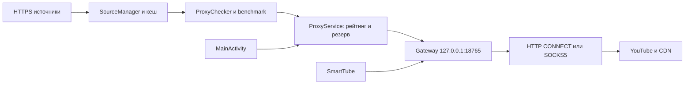
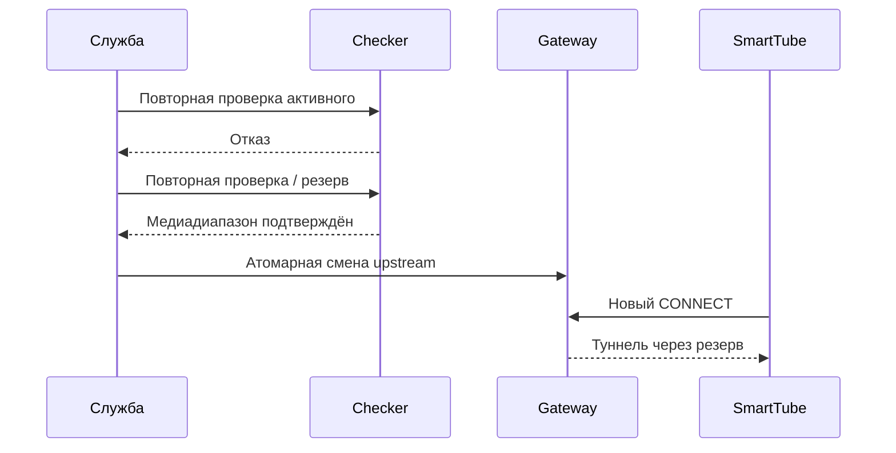

# Архитектура

Java / Android SDK; локальный шлюз, без изменения глобальных настроек. В SmartTube upstream b6a1c8221fa395f91786d29202454b864df2a91e изучены common/.../proxy/ProxyManager.java и AppPrefs.java: HTTP/SOCKS, private web_proxy_uri и web_proxy_enabled. Настраивать через UI SmartTube один раз. Не считать отсутствие обхода доказанным (upstream issue #6105).

Текущий код сохраняет здоровый upstream, проверяет резерв при отказе, но не гарантирует точные интервалы при длительном сканировании. Состояние в памяти, кеш на диске; история, blacklist и сохранение настроек/boot — ещё не реализованы. Проверка через действительную ссылку вводится вручную; необходим собственный подтверждённый механизм получения свежей ссылки без внешнего управляющего сервера. TLS не перехватывается.
